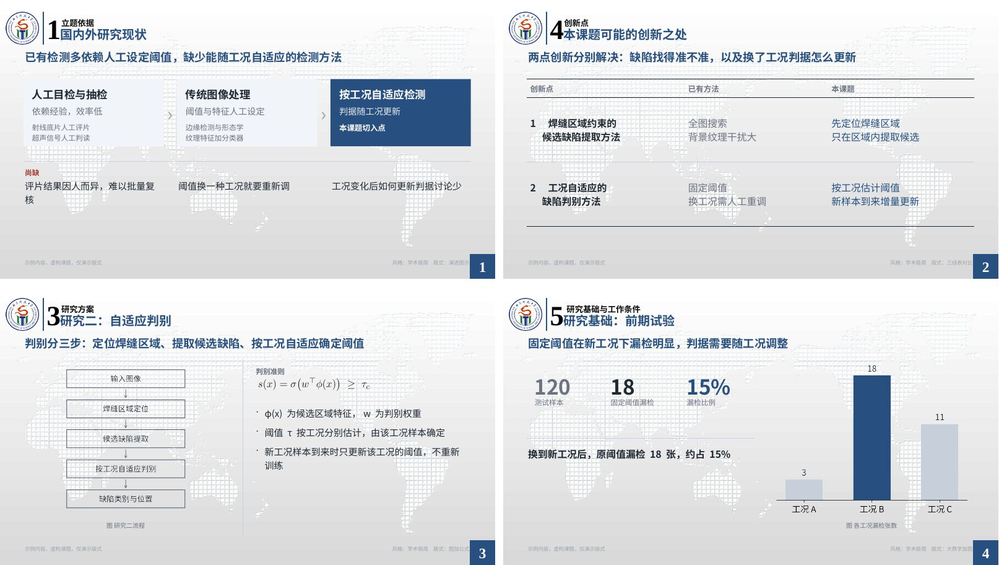

# master-proposal-ppt｜开题答辩 PPT

**简体中文** | [English](README_EN.md) · [项目说明](../README.md) · [仓库首页](../../README.md)

依据已定稿的开题报告，在学校原生开题答辩模板上生成可编辑的答辩 PPT。默认演示模板为西南科技大学，可从任意学校的往届 PPT 抽取模板替换。

## 能做什么

- 学习本校往届开题 PPT 的结构和篇幅（只输出统计结果，不复制原文）；
- 从任意往届 PPT 抽出只含五张骨架页的干净模板（封面、目录、PART 过渡页、内容页页眉、结束页）；
- 提取开题报告 docx 的文字、表格、图片和公式；
- 按 立题依据 / 研究内容与目标 / 研究方案 / 创新点 / 研究基础与工作条件 / 研究计划 六部分逐页规划并生成 pptx；
- 公式为 PowerPoint 可编辑的 Office Math（编译器来自 ppt-master），同时带图片回退；
- 每页写备注讲稿并估算汇报时长（默认 8 到 10 分钟），研究背景可配授权的真实网络照片，研究基础留一页空白放个人成果；
- 先用用户自己的内容出五套风格样页（学术极简、期刊黑白、浅色分区、深色重点、大字结论）让用户挑，选定后全篇统一规则、版式按内容变化，去掉 AI 味；
- 公式页的备注附符号详解与可能的追问（备查，不计入讲稿时长）；
- 渲染逐页 PNG 和总览图，配合文字溢出警告逐页检查。

## 风格样例

`assets/style_gallery/` 里是用虚构示例课题渲染的五套风格，每套 4 页、版式各不相同：

| 学术极简 | 深色重点 |
| --- | --- |
|  |  |

## 安装

```bash
git clone https://github.com/hlf885/skills-Master-student.git
cp -r skills-Master-student/proposal-ppt/master-proposal-ppt ~/.claude/skills/
pip install python-pptx python-docx lxml pillow
```

claude.ai / Claude Cowork：`python scripts/package_skill.py proposal-ppt/master-proposal-ppt` 生成 zip 后上传。公式回退图需要 `pdflatex`、`pdftoppm`，渲染检查需要 LibreOffice。

## 快速试用

```bash
python3 assets/example_build.py . example_deck.pptx --theme 学术极简
python3 scripts/style_gallery.py . gallery_out --render
python3 scripts/render_check.py example_deck.pptx render_out
```

## 目录

```text
master-proposal-ppt/
├── SKILL.md
├── references/      01 模板解剖 · 02 结构与篇幅 · 03 版式 · 04 文字规则 · 05 ppt-master 笔记 · 06 检查清单 · 07 讲稿与图片 · 08 审美与风格
├── scripts/         swust_kit.py · make_template.py · extract_docx.py · outline_dump.py · render_check.py · style_gallery.py · omml/
└── assets/          swust_proposal_template.pptx · example_build.py · style_gallery/
```

## 致谢

工作流与公式编译器来自 [hugohe3/ppt-master](https://github.com/hugohe3/ppt-master)（MIT，Copyright (c) 2025-2026 Hugo He），`scripts/omml/` 中的文件保留原版权说明，许可证见 `scripts/omml/LICENSE_ppt-master`。
