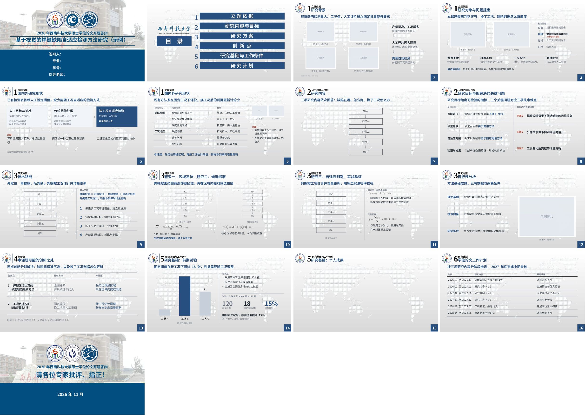
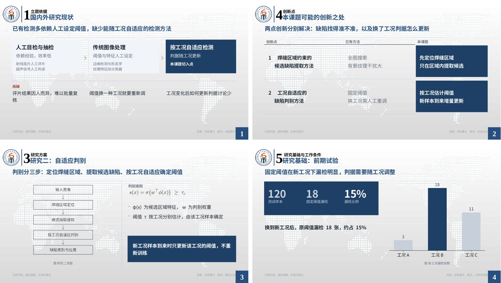

# master-proposal-ppt｜开题答辩 PPT

**简体中文** | [English](README_EN.md) · [项目说明](../README.md) · [仓库首页](../../README.md)

依据已定稿的开题报告，在学校原生开题答辩模板上生成可编辑的答辩 PPT。默认演示模板为西南科技大学，可从任意学校的往届 PPT 抽取模板替换。

## 能做什么

- 学习本校往届开题 PPT 的结构和篇幅（只输出统计结果，不复制原文）；
- 从任意往届 PPT 抽出只含五张骨架页的干净模板（封面、目录、PART 过渡页、内容页页眉、结束页）；
- 提取开题报告 docx 的文字、表格、图片和公式；
- 按 立题依据 / 研究内容与目标 / 研究方案 / 创新点 / 研究基础与工作条件 / 研究计划 六部分逐页规划并生成 pptx；
- 公式为 PowerPoint 可编辑的 Office Math（编译器来自 ppt-master），同时带图片回退；
- 每页写备注讲稿并估算汇报时长（默认 8 到 10 分钟），研究背景可配授权的真实网络照片，研究基础留一页空白放个人成果；
- 先用用户自己的内容出六套风格样页（V3实例、学术极简、期刊黑白、浅色分区、深色重点、大字结论）让用户挑，选定后全篇统一规则、版式按内容变化，去掉 AI 味；
- V3实例 是用户反馈很好的整套做法：17 页逐页版式配方，照着填开题报告内容即可生成；
- 公式页的备注附符号详解与可能的追问（备查，不计入讲稿时长）；
- 渲染逐页 PNG 和总览图，配合文字溢出警告逐页检查。

## 风格样例

`assets/style_gallery/` 里是用虚构示例课题渲染的六套风格，每套 4 页、版式各不相同。

**V3实例（推荐）**：全套 17 页总览



| 学术极简 | 深色重点 |
| --- | --- |
|  |  |

其余见 `assets/style_gallery/`。

## 安装

本 Skill 是通用的 SKILL.md 格式，Codex、Claude Code、claude.ai 都能用。先装 Python 依赖：

```bash
pip install python-pptx python-docx lxml pillow matplotlib
```

渲染检查需要 LibreOffice，公式回退图需要 `pdflatex` 和 `pdftoppm`；没有也能生成 PPT，只是少了渲染检查。

### Codex

在 Codex 会话里用自带的安装器：

```text
$skill-installer install https://github.com/hlf885/skills-Master-student/tree/main/proposal-ppt/master-proposal-ppt
```

或手动安装到个人技能目录 `~/.agents/skills`：

```bash
# macOS / Linux
git clone --depth 1 https://github.com/hlf885/skills-Master-student.git /tmp/sms
mkdir -p ~/.agents/skills && cp -r /tmp/sms/proposal-ppt/master-proposal-ppt ~/.agents/skills/
```

```powershell
# Windows PowerShell
git clone --depth 1 https://github.com/hlf885/skills-Master-student.git "$env:TEMP\sms"
New-Item -ItemType Directory -Force "$HOME\.agents\skills" | Out-Null
Copy-Item -Recurse -Force "$env:TEMP\sms\proposal-ppt\master-proposal-ppt" "$HOME\.agents\skills\"
```

装好后没出现就重启 Codex，输入 `/skills` 可查看。

### Claude Code / claude.ai

```bash
git clone https://github.com/hlf885/skills-Master-student.git
cp -r skills-Master-student/proposal-ppt/master-proposal-ppt ~/.claude/skills/
```

claude.ai：在仓库根目录运行 `python scripts/package_skill.py proposal-ppt/master-proposal-ppt` 生成 zip，在设置的 Skills 中上传。

## 使用（Codex 示例，Claude 中把 `$master-proposal-ppt` 换成 `/master-proposal-ppt` 或直接描述需求）

在放开题材料的文件夹里启动 `codex`，粘贴下面的指令，把尖括号内容换成自己的：

```text
$master-proposal-ppt
请按这个 skill 的完整流程，依据我的开题报告制作开题答辩 PPT。
- 开题报告：<开题报告.docx 的路径>
- 本校往届开题答辩 PPT：<文件夹路径，没有就写 无>；重点参考：<某一份的文件名，没有就删掉这行>
- 学校模板：<从往届 PPT 抽取本校模板 / 先用 skill 自带的西南科技大学模板>
- 汇报时长：<例如 8 到 10 分钟>
- 答辩日期：<例如 2026年12月>

要求：
1. 先复述 PPT 的宗旨，跟我确认需求，再列出逐页规划（每页的结论句、版式、用哪张图）给我看。
2. 做整套之前，用 scripts/style_gallery.py 拿我开题报告里的 4 页内容出各套风格样页，渲染成图让我挑；我也可以直接选 V3实例。
3. 全篇规则统一，但每页版式按内容变化，不能页页一个样；不要 AI 味。
4. 每页写备注讲稿，总时长控制在汇报时长内；有公式的页，在备注的备查部分逐个解释符号，并写出可能的追问和回答，内容只能来自开题报告。
5. 封面个人信息和研究基础的个人成果页留空，由我自己填。
6. 生成后渲染检查每一页，输出 pptx 和生成脚本，新版本另存为新文件，不要覆盖旧版本。
```

直接用 V3实例：

```text
$master-proposal-ppt
我选 V3实例 风格。请依据 <开题报告.docx 的路径>，按 assets/presets/v3_deck.py 的 17 页配方填入我的内容生成整套 PPT，
先给我看逐页规划和每页结论句，确认后再生成；其余要求同上。
```

按修改意见改：

```text
$master-proposal-ppt
读 <修改意见文件的路径>，先复述你理解的每条意见并跟我确认，再基于上一版的生成脚本修改。
新版另存为新文件，最后给我一张修改记录表。
```

## 快速试用

```bash
python3 assets/example_build.py . example_deck.pptx --theme 学术极简
python3 scripts/style_gallery.py . gallery_out --render
python3 assets/presets/v3_deck.py . v3_example.pptx
python3 scripts/render_check.py example_deck.pptx render_out
```

## 目录

```text
master-proposal-ppt/
├── SKILL.md
├── references/      01 模板解剖 · 02 结构与篇幅 · 03 版式 · 04 文字规则 · 05 ppt-master 笔记 · 06 检查清单 · 07 讲稿与图片 · 08 审美与风格
├── agents/          openai.yaml（Codex 界面元数据）
├── scripts/         swust_kit.py · make_template.py · extract_docx.py · outline_dump.py · render_check.py · style_gallery.py · omml/
└── assets/          swust_proposal_template.pptx · example_build.py · presets/v3_deck.py · style_gallery/
```

## 致谢

工作流与公式编译器来自 [hugohe3/ppt-master](https://github.com/hugohe3/ppt-master)（MIT，Copyright (c) 2025-2026 Hugo He），`scripts/omml/` 中的文件保留原版权说明，许可证见 `scripts/omml/LICENSE_ppt-master`。
