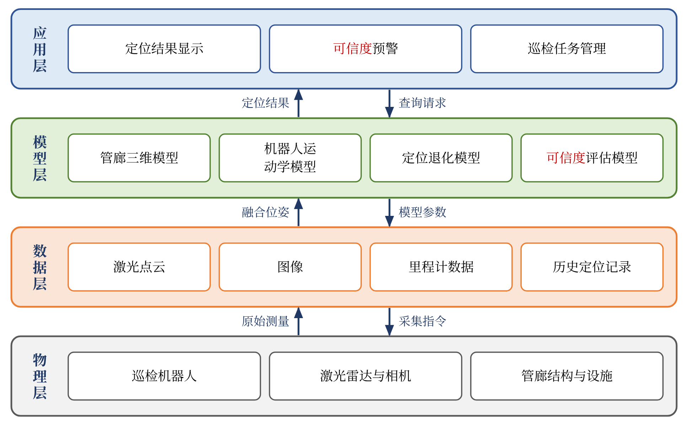
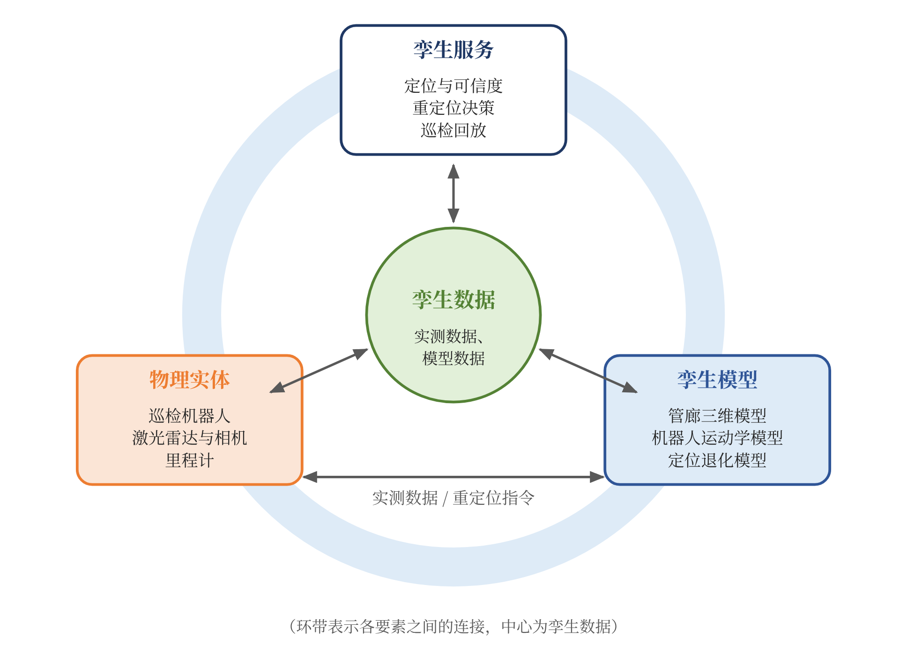
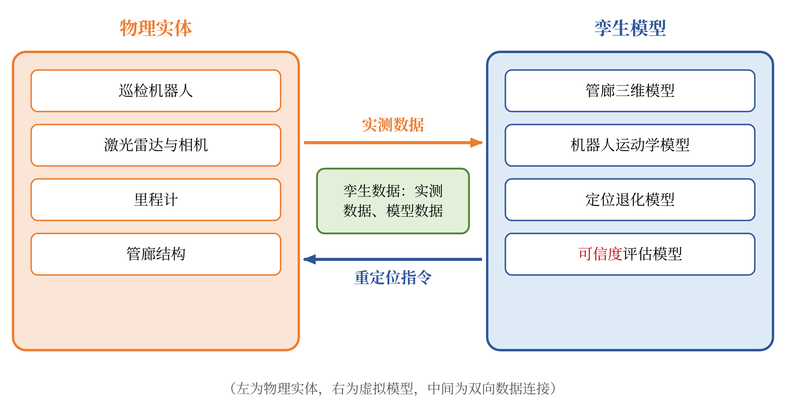
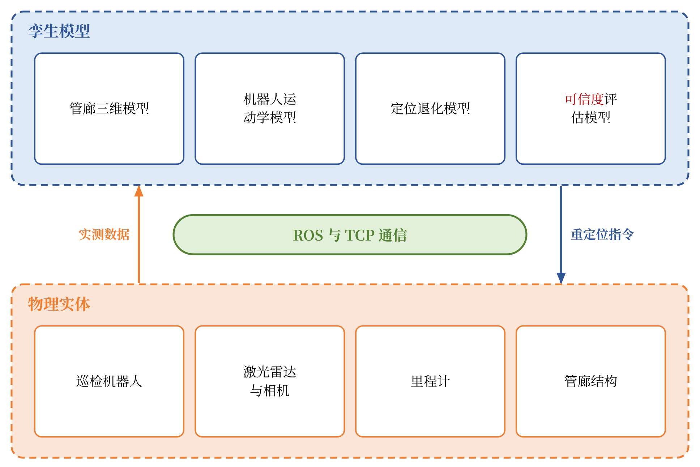
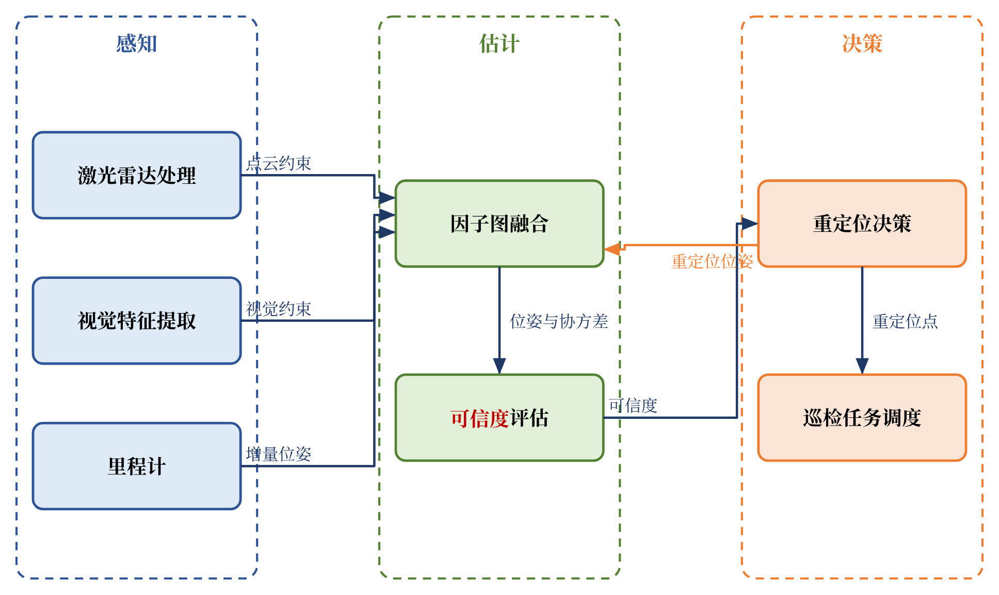
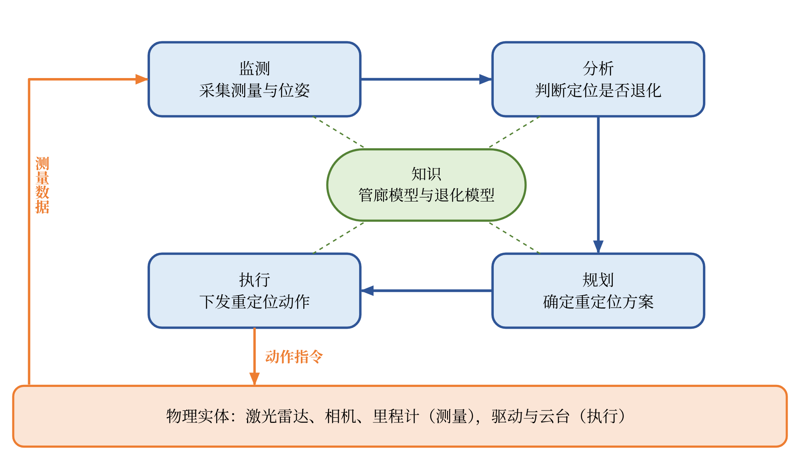

# 架构与框架图（系统、模型架构类）画法图库

示例内容是虚构课题“管廊巡检机器人的数字孪生定位系统”，只用来展示画法。总览见 `gallery-overview.png`，单张示例见 `example_A*.png`，示例内容见 `content-example.json`。

## A1 分层堆叠式

- 来源：学习模板和本仓库作者开题报告图3-3（孪生模型分层）。
- 结构：自上而下应用层、模型层、数据层、物理层，层间一对箭头写上下传递的内容。
- 适合：系统组成清楚、层次分明；读者懂行或中间档。
- 优点：规范，层次与职责清楚。
- 缺点：看不出模块之间的具体数据流。

## A2 四要素环形

- 来源：学习模板中一份开题报告的数字孪生系统图，其依据是陶飞等提出的数字孪生五维模型（物理实体、虚拟模型、服务、孪生数据和连接）。
- 结构：孪生数据居中，物理实体、虚拟模型、服务围绕，环带表示各要素之间的连接。
- 适合：需要说明数字孪生系统由哪些要素组成。
- 优点：概念完整，与数字孪生文献的表述一致。
- 缺点：偏概念，看不出具体模块和算法。

## A3 虚实左右映射式

- 来源：Grieves 提出的数字孪生概念（物理实体、虚拟模型以及连接二者的数据与信息），国外数字孪生文献和博士论文中常用这种左右对照的画法。
- 结构：左为物理实体，右为虚拟模型，中间上下两条反向箭头分别写实测数据和控制指令。
- 适合：重点是虚实之间传递什么；读者不懂行或中间档。
- 优点：最直观，外行也能看懂虚实关系。
- 缺点：内部模块只能列举，层次较浅。

## A4 上虚下实分区式

- 来源：学习模板中两份开题报告的数字孪生系统整体结构图（上方 Unity 虚拟端，下方 ROS 实体端）。
- 结构：上方虚拟端模块，下方实体端设备，中间通信层，两侧箭头写上传的数据和下发的指令。
- 适合：已经确定软件平台和通信方式的系统；读者懂行。
- 优点：实现路线清楚，便于说明可行性。
- 缺点：偏工程实现，学术问题不突出。

## A5 模块与数据流式

- 来源：机器人系统中常用的模块框图，与 ROS 节点和话题组成的计算图画法一致；加州理工学院 Csomay-Shanklin 2025 年博士论文图5.4 的多速率控制架构图（包含基于模型预测控制的全身规划和低层跟踪控制器）也属于这一类。
- 结构：按功能分组（感知、估计、决策），组内是模块，箭头上写传递的数据，反向箭头用另一种颜色。
- 适合：算法模块多、数据接口重要；读者懂行。
- 优点：模块与接口清楚，便于后续编程实现。
- 缺点：箭头多时容易乱，模块宜控制在 8 个以内。

## A6 闭环自主架构

- 来源：IBM 自主计算提出的 MAPE-K 环（监测、分析、规划、执行围绕共享知识，Kephart 与 Chess 2003 年发表于 IEEE Computer），欧洲自适应系统和数字孪生方向的论文常用。
- 结构：四个环节顺时针闭环，中间是共享知识（模型、地图），底部物理实体提供测量、接收动作指令。
- 适合：系统需要根据状态在线调整决策；强调闭环。
- 优点：闭环逻辑清楚，有成熟出处，便于答辩时解释。
- 缺点：抽象，需要在正文中说明每个环节对应的具体方法。
