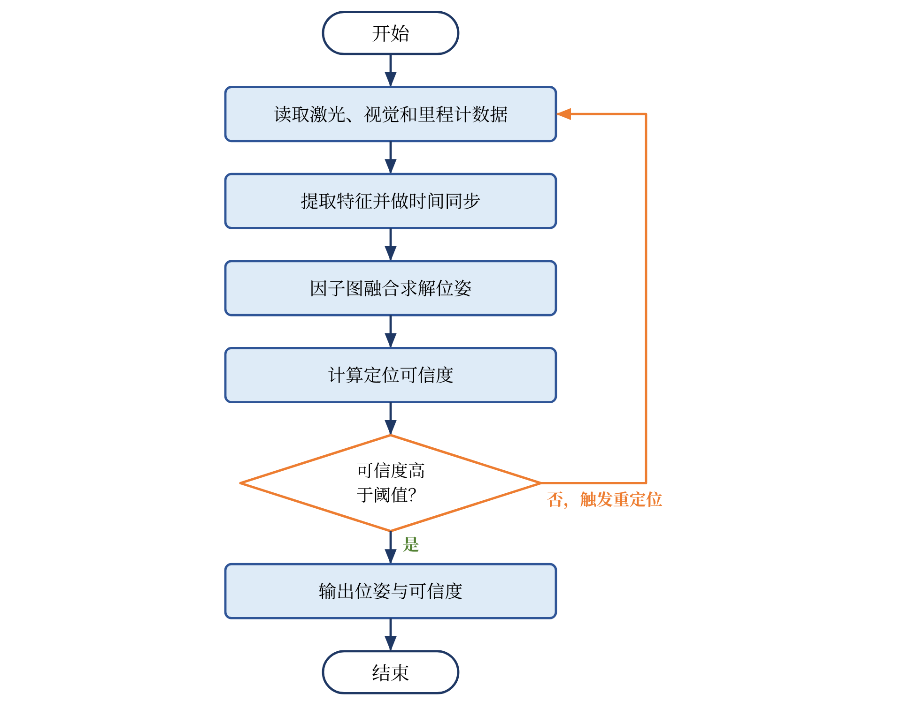
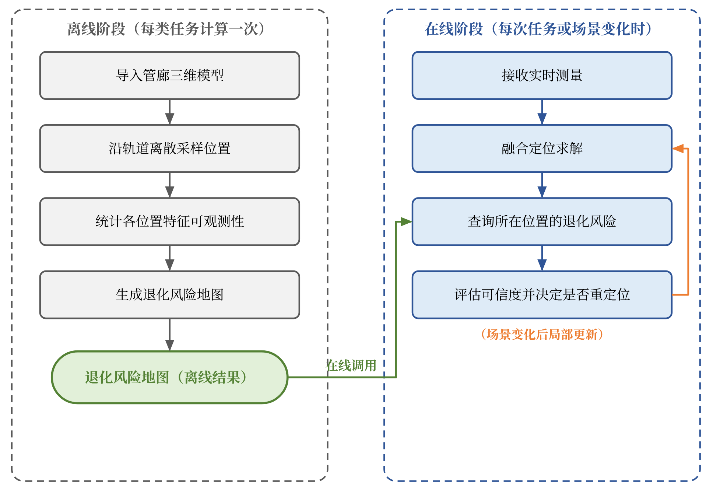
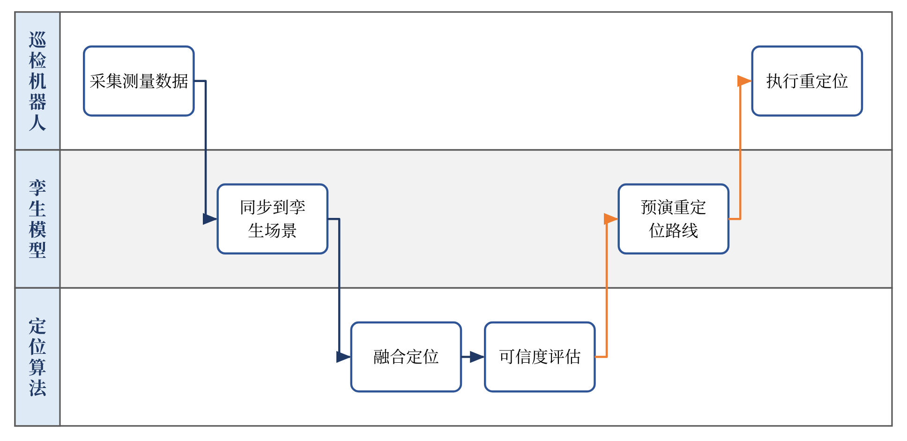
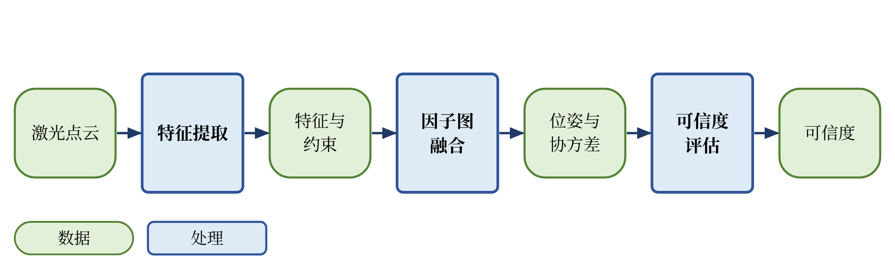
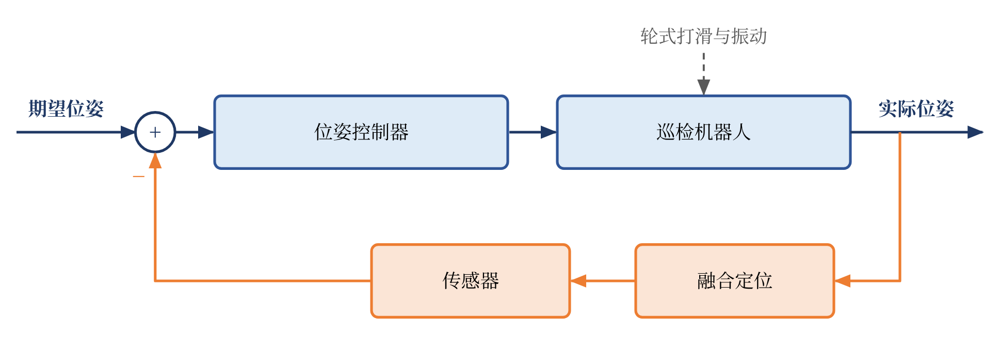
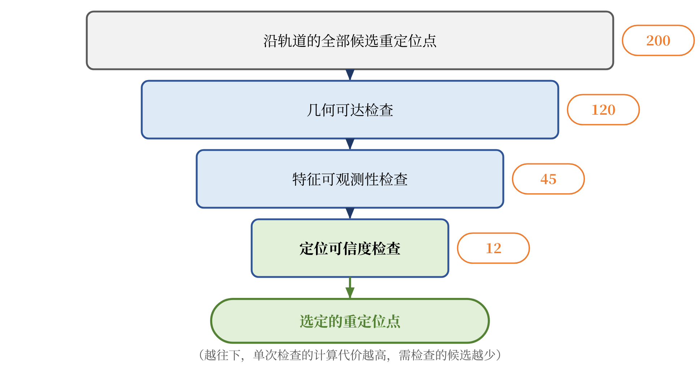

# 算法流程图（方法流程类）画法图库

示例内容是虚构课题“管廊巡检机器人的多源融合定位与重定位”，只用来展示画法。总览见 `gallery-overview.png`，单张示例见 `example_F*.png`，示例内容见 `content-example.json`。

## F1 标准程序流程图

- 来源：学习模板中的算法流程图（如灰狼算法流程图）；符号与 GB/T 1526 及 ISO 5807 的程序流程图一致（起止框、处理框、判断菱形）。
- 适合：单个算法的步骤，有判断和循环。
- 优点：人人看得懂，规范。
- 缺点：只能表达一条主线，不适合多模块协作。

## F2 离线在线分区式

- 来源：本仓库作者开题报告图3-4、图3-5 的写法；可达性图、能力图类方法普遍采用离线构建、在线查询的思路。
- 结构：左侧离线阶段（每类任务算一次），右侧在线阶段，中间是离线结果库，箭头写在线调用，场景变化时的局部更新单独标出。
- 适合：有预计算的方法；想强调在线计算量小。
- 优点：清楚说明哪些是一次性计算，哪些每次都算。
- 缺点：两侧步骤都要精简。

## F3 泳道式

- 来源：业务流程建模标准 BPMN 与 UML 活动图中的泳道画法。
- 结构：每条泳道代表一个执行者或模块，步骤按时间从左到右，跨道箭头表示交接。
- 适合：多个模块、设备或软件之间协作的流程，如实体设备、孪生模型、规划算法之间的交互。
- 优点：谁在什么时候做什么一目了然。
- 缺点：步骤多时图很宽，宜控制在 6–8 步。

## F4 数据流水线式

- 来源：学习模板中的网络结构图；深度学习和数据处理论文常用。
- 结构：数据框与处理框交替，从左到右。
- 适合：数据处理链条清楚、没有分支的方法。
- 优点：输入输出清楚。
- 缺点：不能表达判断和循环。

## F5 控制框图式

- 来源：学习模板中的视觉伺服流程图；控制方向的标准方框图。
- 结构：参考输入、求和点、前向通道、输出、反馈通道，可标出扰动。
- 适合：控制、跟踪、伺服类方法。
- 优点：控制专家熟悉，表达严谨。
- 缺点：不懂行的读者看不懂求和点和反馈符号，需配一句说明。

## F6 逐级筛选漏斗式

- 来源：本仓库作者开题报告图3-5 的分级筛选思路；任务与运动规划研究中“先用代价低的判断排序，只对排在前面的做完整检查”的做法。
- 结构：自上而下逐级检查，越往下检查越精细、代价越高，右侧标每级剩余的候选数量。
- 适合：候选生成与筛选类方法；想强调计算量如何被逐级压缩。
- 优点：一眼看出为什么方法高效。
- 缺点：示例中的数量要来自前期实验或写明是示意。
