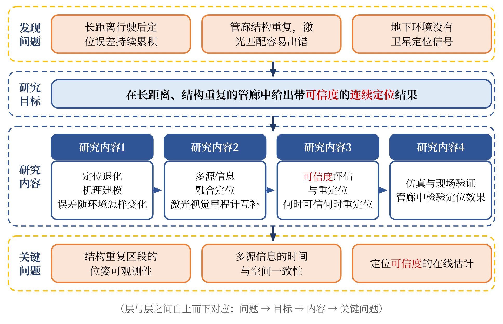
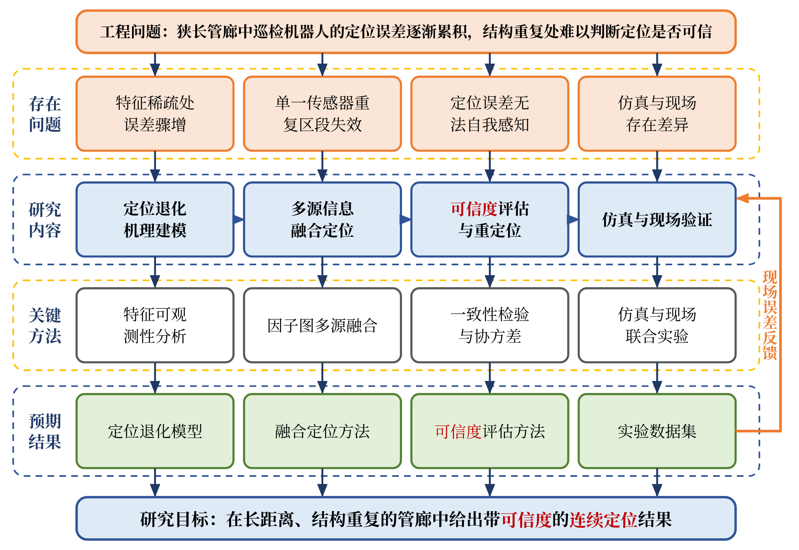
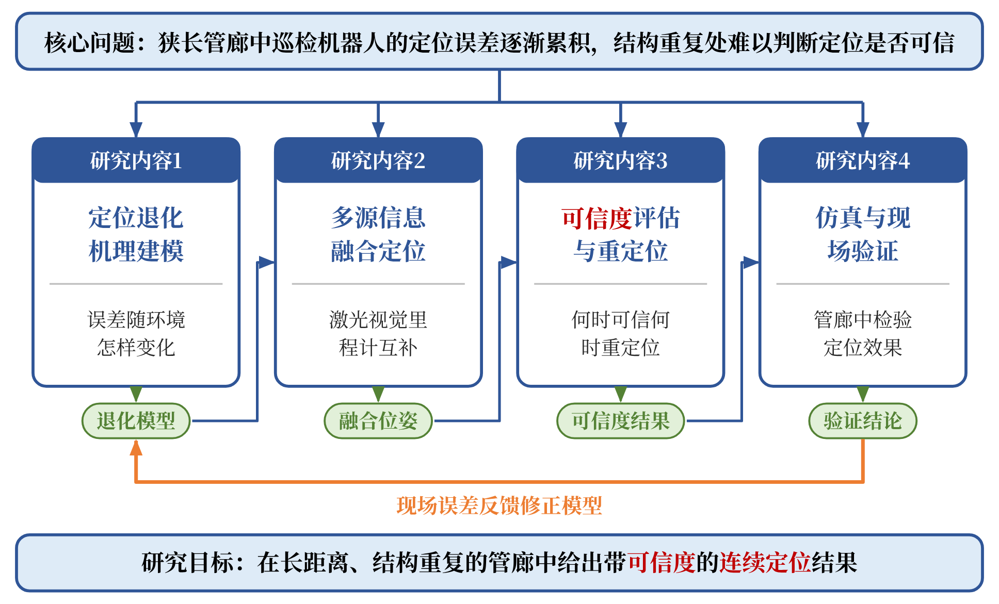
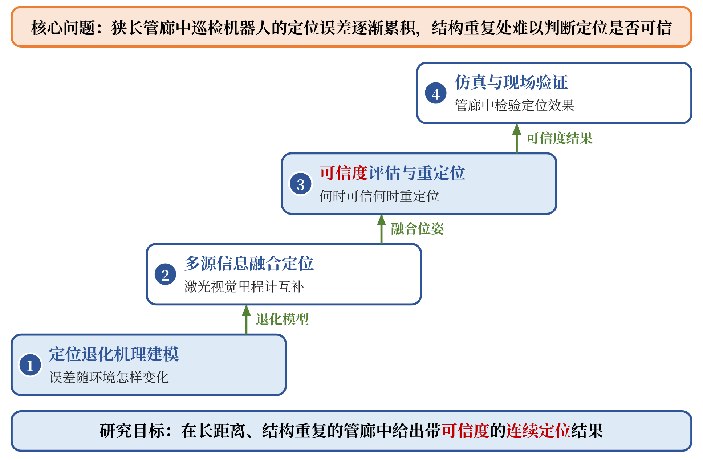
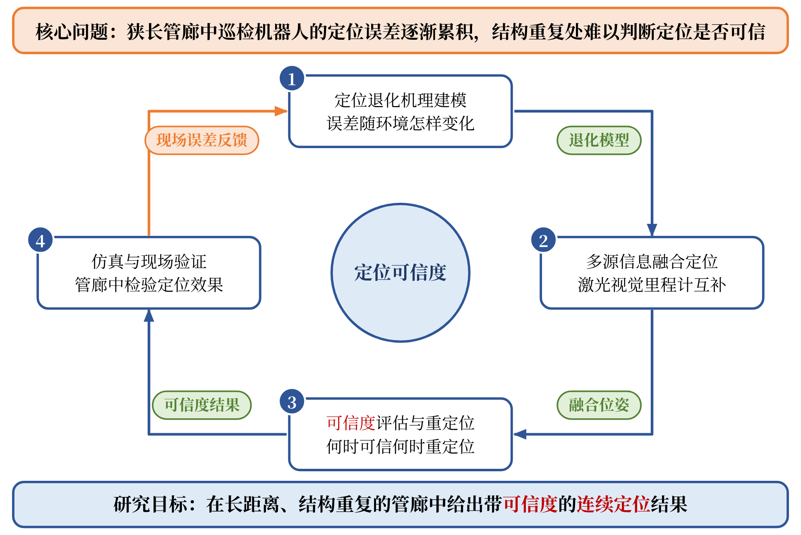
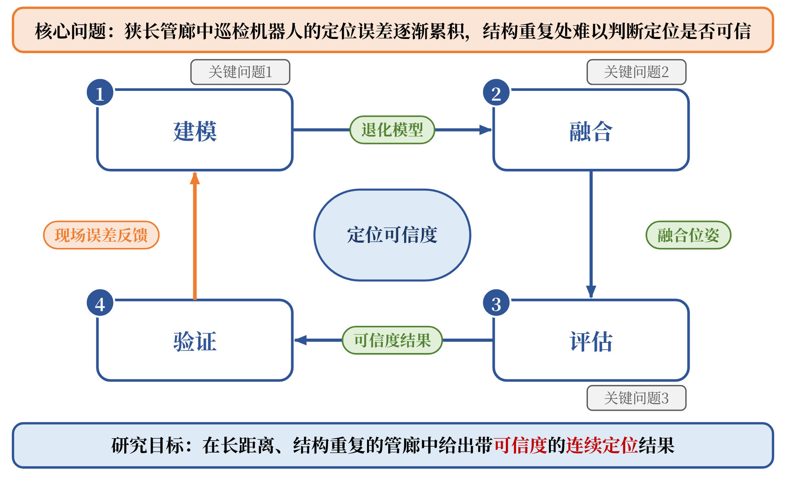
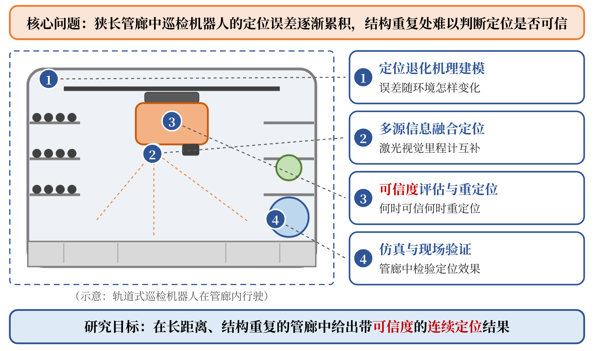
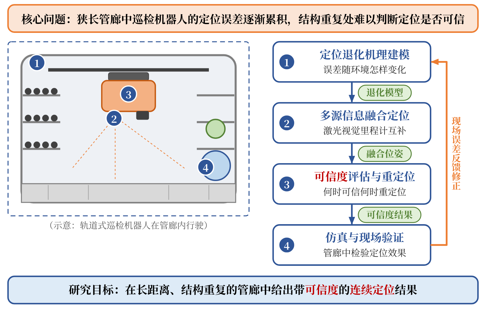
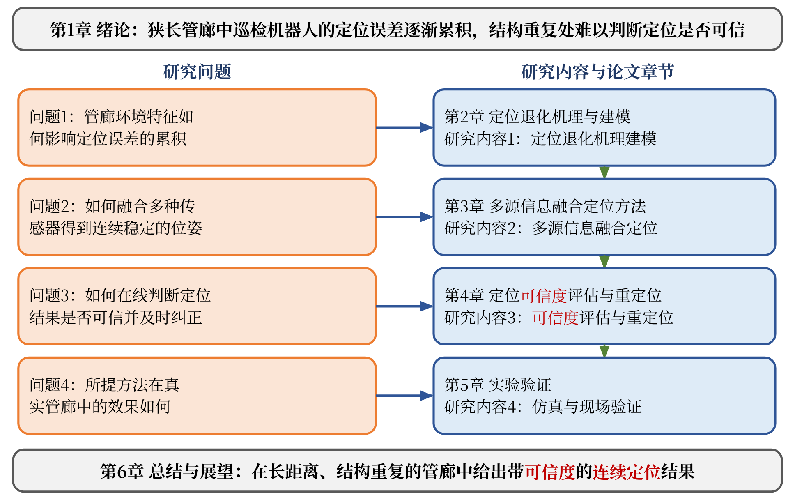

# 研究内容图（图2-1 类）画法图库

示例内容是虚构课题“基于多源信息融合的狭长管廊巡检机器人定位方法研究”，场景图为示意画，只用来展示画法。全部画法的总览见 `gallery-overview.png`，每种画法的单张示例见 `example_R*.png`，示例用的内容见 `content-example.json`。

用法：先按 `references/12-figure-styles.md` 第二节问清需求，再把 `gallery-overview.png` 和下面的卡片发给用户，给出推荐，让用户挑 2–3 种，然后用用户自己的内容执行
`python scripts/draw_figure.py 规格.json -o 输出目录 --style R8 --formats svg,png,vba`
（`--formats` 按用户选择的格式填写）。

读者档位：懂行＝本方向专家；中间＝相关领域（懂工程或机器人，但不做这个方向）；不懂行＝其他学科。

---

## R1 分层框图

- 来源：学习模板（师兄师姐开题报告）中最常见的画法。
- 结构：发现问题 → 研究目标 → 研究内容 → 关键问题，四层自上而下，黄蓝虚线分层，重点词标红。
- 适合：学校或导师习惯模板式框图；需要一眼看出问题、目标、内容、关键问题四者的对应；读者以懂行为主。
- 优点：规范，与学习模板一致，要素齐全。
- 缺点：格子多、字多；层与层之间只是整体对应，看不出各项内容之间的递进和反馈。
- 不适合：研究内容之间前后依赖很强、需要表达闭环的课题。
- 需要的内容：findings（2–3 条）、goal、items（name、short）、key_problems（2–3 条）。

## R2 五层四列

- 来源：本仓库作者开题报告 V7–V8 的迭代画法。
- 结构：工程问题 → 存在问题 → 研究内容 → 关键方法 → 预期结果 → 研究目标，一列对应一项研究内容，外圈反馈线闭环。
- 适合：要求每项内容的问题、方法、结果一一对应；读者为懂行或中间档。
- 优点：对应关系最完整，有闭环。
- 缺点：二十多个框，插入 Word 后字很小。作者后来认为不懂行的老师看不懂，改用了 R8。
- 需要的内容：problem、goal、feedback、items（issue、name、method、result）。

## R3 横向闭环链

- 来源：作者重画图2-1 时的候选方案之一。
- 结构：四项研究内容横排，每项下方写产出，产出接到下一项，最后一项的结果反馈回第一项。
- 适合：四项内容依次衔接、产出传递明确；读者为中间档。
- 优点：前后衔接和闭环一眼可见。
- 缺点：每列宽度有限，每项只能写很少的字；作者认为它的观感像普通流程图，没有选用。
- 需要的内容：problem、goal、feedback、items（name、short、output）。

## R4 阶梯递进

- 来源：作者重画图2-1 时的候选方案之一。
- 结构：四项内容从左下到右上逐级上升，台阶之间写产出。
- 适合：强调由机理到方法再到验证的逐级提升；不需要表达反馈。
- 优点：递进关系最直观。
- 缺点：没有闭环；占的高度较大。
- 需要的内容：problem、goal、items（name、short、output）。

## R5 环形循环

- 来源：作者重画图2-1 时的候选方案之一。
- 结构：四项内容围绕一个核心对象顺时针排列，箭头上写产出，最后一段用醒目颜色表示反馈。
- 适合：研究内容围绕一个核心对象反复迭代。
- 优点：核心对象突出，循环关系明确。
- 缺点：起点和顺序不如线性排列清楚；作者认为不够清晰，没有选用。
- 需要的内容：problem、goal、core、feedback、items（name、short、output）。

## R6 概念闭环

- 来源：参考 Leidner 2017 年博士论文（不来梅大学、德国宇航中心）中的概念闭环总览图。
- 结构：每项研究内容只写一个概念词，四个概念围绕核心对象闭环，箭头上写产出，旁边标对应的关键问题。
- 适合：读者以不懂行或中间档为主；方法论框架清楚的课题。
- 优点：最简洁，外行也能看懂。
- 缺点：信息少，具体内容要靠正文补充。
- 需要的内容：problem、goal、core、feedback、items（concept、output，可选 kp）。

## R7 场景标注

- 来源：参考 Holladay 2024 年博士论文（麻省理工学院）用任务场景图交代研究目标的做法。
- 结构：左侧是场景图，用编号标出各项研究内容作用的部位，右侧列出四项内容。
- 适合：有清晰的场景图或实物图；研究内容相对并列；读者以不懂行为主。
- 优点：外行一看就知道研究对象和每项内容管哪一部分。
- 缺点：不表达内容之间的递进和闭环；必须有场景图。
- 需要的内容：problem、goal、scene、scene_marks、scene_caption、items（name、short）。

## R8 场景图加四步闭环

- 来源：作者开题报告最终选定的图2-1 画法（V10 起），综合了 R7 的场景图和 R6 的闭环。
- 结构：左侧是场景图并标号，右侧四步竖排，箭头旁写产出，侧边反馈线闭环，顶部是核心问题，底部是研究目标。
- 适合：有场景图；读者懂行、中间、不懂行都有；研究内容有前后衔接和反馈。
- 优点：外行靠场景图看懂对象，懂行的人能看到递进和闭环。
- 缺点：必须有场景图；研究内容以 3–4 项为宜。
- 需要的内容：problem、goal、feedback、scene、scene_marks、scene_caption、items（name、short、output）。

## R9 研究问题与章节对应

- 来源：参考 Trevisan 2025 年博士论文（代尔夫特理工大学）中研究问题与章节对应的结构图。
- 结构：左列是研究问题，右列是对应的研究内容和论文章节，上下分别是绪论与总结。
- 适合：理论性较强、以研究问题组织全文的课题；也可以在学位论文绪论中复用。
- 优点：研究问题与工作量的对应一目了然。
- 缺点：开题阶段章节安排可能未定；不表达闭环。
- 需要的内容：problem、goal、items（question、chapter、name）。
