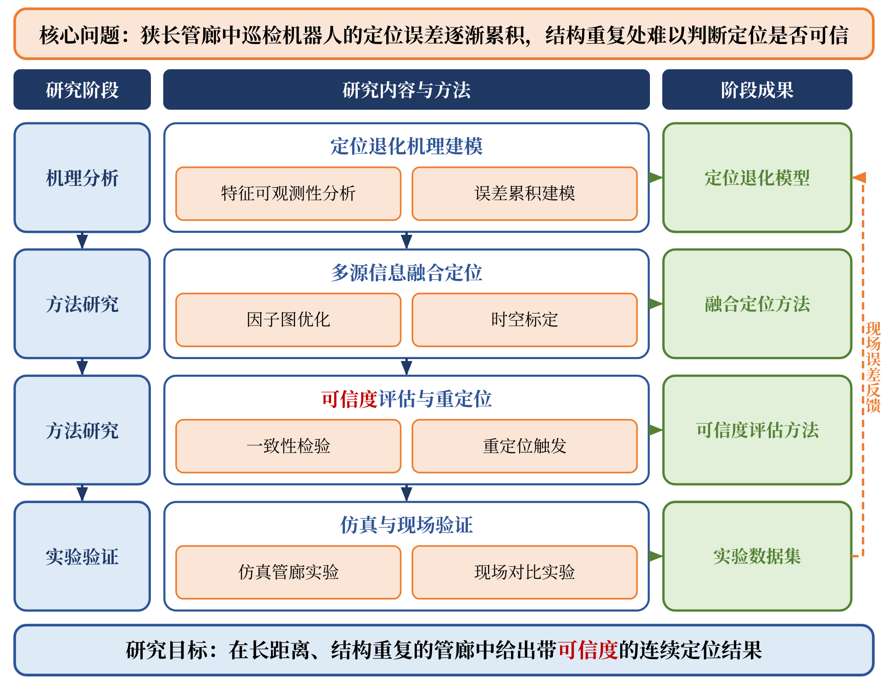
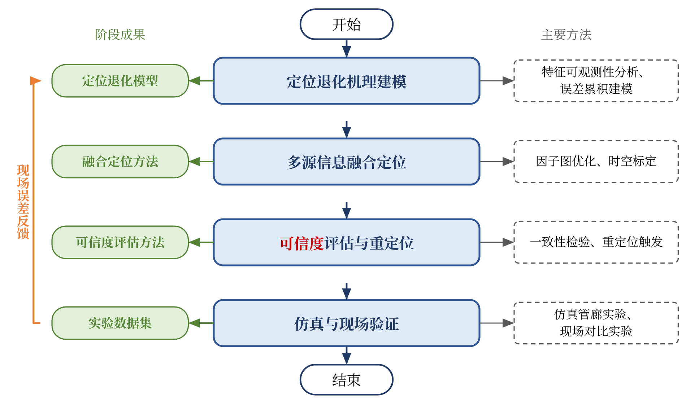
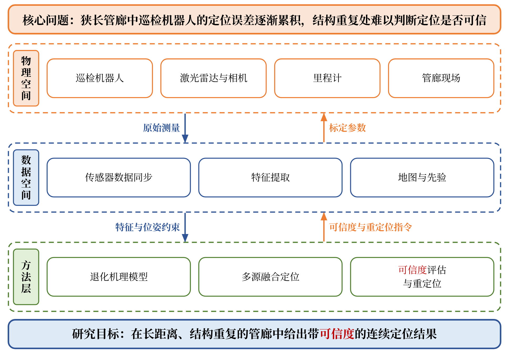
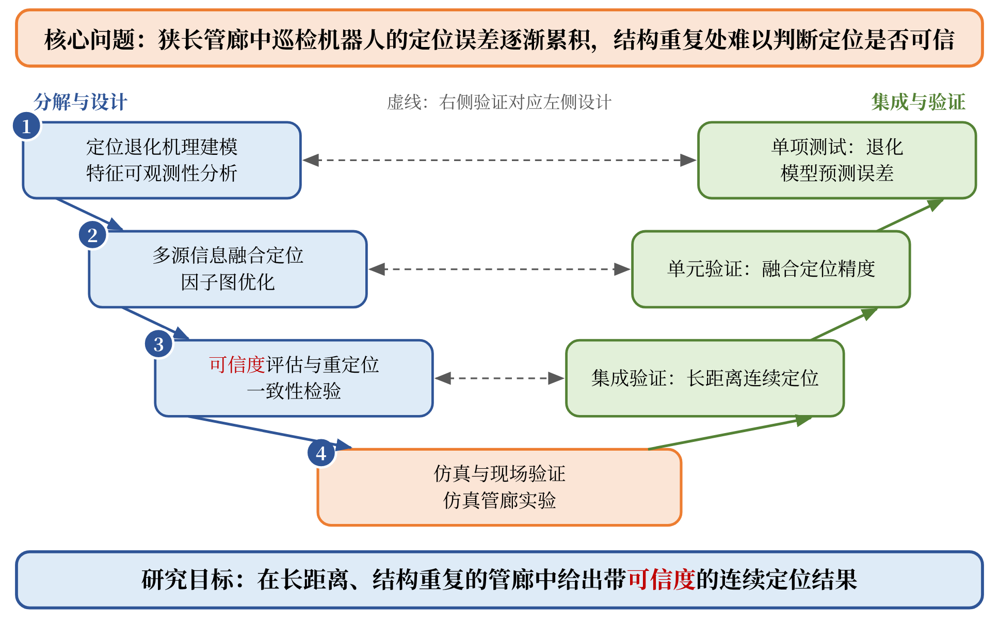
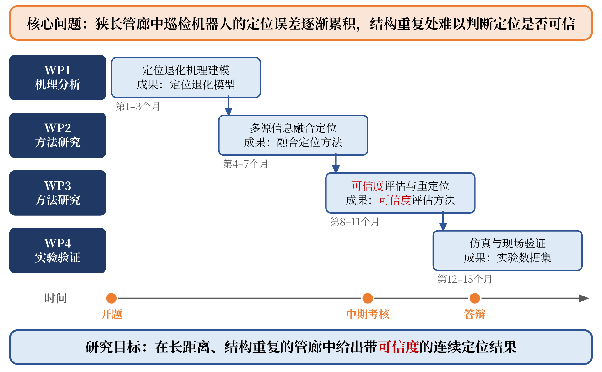

# 技术路线图（图3-1 类）画法图库

示例内容是虚构课题“基于多源信息融合的狭长管廊巡检机器人定位方法研究”，只用来展示画法。总览见 `gallery-overview.png`，单张示例见 `example_T*.png`，示例内容见 `content-example.json`。用法同研究内容图：先按 `references/12-figure-styles.md` 问清需求，展示总览和卡片，给出推荐，用户挑选后执行 `python scripts/draw_figure.py 规格.json -o 输出目录 --style T1 --formats 用户选择的格式`。

## T1 三栏式

- 来源：学习模板（师兄师姐开题报告）和本仓库作者开题报告图3-1。
- 结构：左栏研究阶段，中栏研究内容与主要方法，右栏阶段成果，侧边反馈线。
- 适合：读者为懂行或中间档；希望阶段、方法、成果一一对应。
- 优点：信息完整，与学习模板一致。
- 缺点：字较多；成果栏不能写论文（见 `02-section-guide.md`）。

## T2 竖向主干流程式

- 来源：学习模板中两份开题报告的技术路线图（开始、主干步骤、结束，侧边为外部对象和状态同步）。
- 结构：中间一条竖向主干，右侧虚线框写主要方法，左侧写阶段成果，左侧括号线表示反馈。
- 适合：研究步骤先后关系清楚；读者以中间档或不懂行为主。
- 优点：流程感强，一眼看出先做什么后做什么。
- 缺点：方法只能写短语；不适合表达并行的研究内容。

## T3 空间分层式

- 来源：学习模板中一份开题报告的技术路线图（物理空间、虚拟空间、算法控制三条横带）。
- 结构：自上而下的几条横带（物理空间、数据空间、方法层等），带内放模块，带间用双向箭头写传递的数据和指令。
- 适合：数字孪生、虚实交互类课题；想强调“在哪一层做什么”。
- 优点：虚实关系和数据流向清楚。
- 缺点：时间顺序不明显，常需在正文或工作计划中补充先后。

## T4 V 模型

- 来源：德国工程师协会 VDI 2206 机电系统开发指南中的 V 模型，常见于机电与系统工程方向的研究路线。
- 结构：左侧自上而下逐级分解与设计，底部是实现或综合实验，右侧自下而上逐级集成与验证，虚线连接设计与对应的验证。
- 适合：工程系统类课题；评审重视“每一步设计怎样被验证”。
- 优点：设计与验证一一对应，体现严谨。
- 缺点：国内开题中较少见，部分评审需要口头解释；不强调时间。

## T5 工作包与里程碑式

- 来源：欧洲科研项目申请书和博士研究计划中常见的工作包（Work Package）结构，带时间轴和里程碑。
- 结构：左侧工作包编号与名称，右侧按时间错开的工作条，条内写内容与成果，底部时间轴标开题、中期、答辩等里程碑。
- 适合：希望同时表达研究路线和进度；与工作计划表呼应。
- 优点：时间与依赖关系一目了然。
- 缺点：方法细节少；与工作计划表有重复，二者择一详写。
