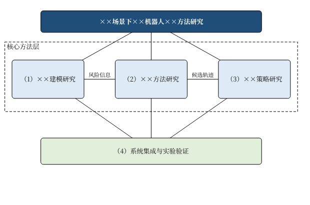

<!-- 脚本冒烟测试用的最小样例（内容为虚构示意，不完整，自检会报告缺失项属正常）。 -->

# 论文题目：狭长管廊巡检机器人定位方法研究

# 一、立题依据

## 1.1 研究目的及意义

管廊巡检长期依赖人工，存在效率低、风险高的问题^[1]^。《“十四五”机器人产业发展规划》提出加快特种机器人研制^[2,3]^。

如图1-1所示，本课题拟研究定位方法^[4-5]^。

## 1.4 参考文献

[1] 陶飞, 刘蔚然, 张萌, 等. 数字孪生五维模型及十大领域应用[J]. 计算机集成制造系统, 2019, 25(1): 1-18.
[2] Thrun S, Burgard W, Fox D. Probabilistic robotics[M]. Cambridge: MIT Press, 2005.

# 三、研究方案设计及可行性分析

## 3.2 理论分析

状态转移模型为：

$$ \boldsymbol{x}_{k+1} = \boldsymbol{F}\boldsymbol{x}_k + \boldsymbol{w}_k \tag{3-1} $$

式中，$\boldsymbol{F}$ 为状态转移矩阵。

表3-1　候选方案对比

| 方案 | 优点 | 局限 |
| --- | --- | --- |
| A | 实时性好 | 精度一般 |

# 学位论文工作计划

| 时间 | 研究内容 | 预期效果 |
| --- | --- | --- |
| 2026.01-2026.04 | 文献调研 | 完成开题 |
